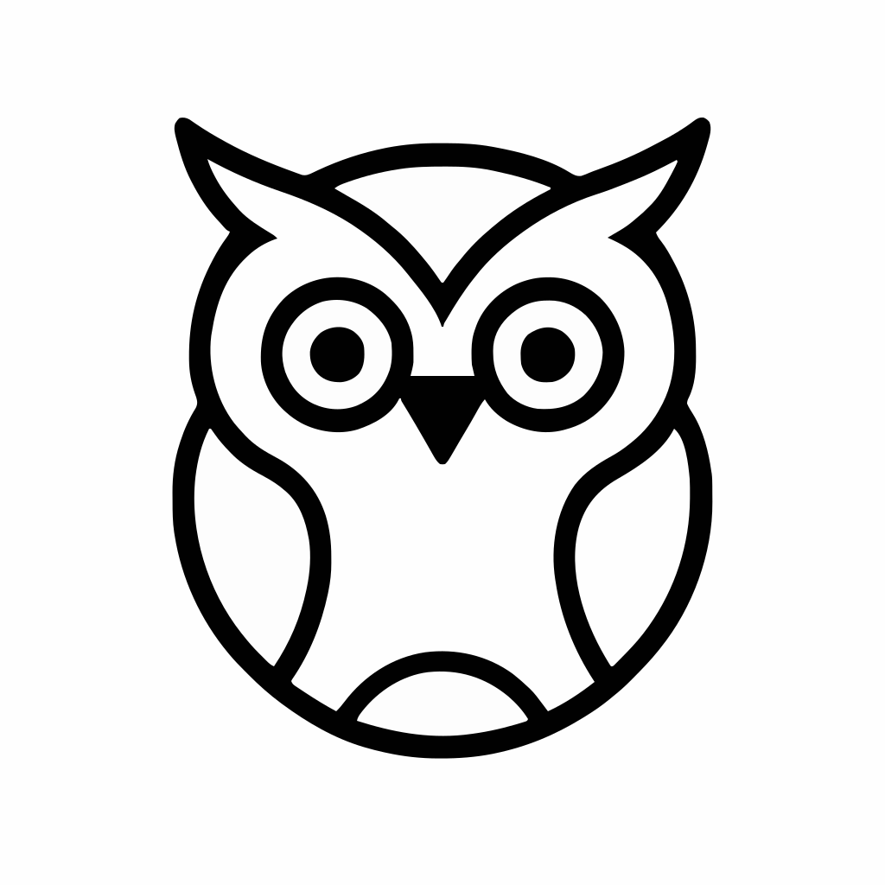

# owl


Owl is a highly opinionated framework for Go.

## Purpose
Owl aims to be a web framework focused on building server-rendered websites with:

* Server-side rendering
* Localization (i18n)
* Automatic cookie encryption
* CORS support
* CSRF tokens
* Session management
* Form validation with error rendering
* Optional Dependency Injection Container

All features are tightly integrated with each other and implemented with a minimal number of external dependencies (currently only 3, one of which is developed in-house).

## Example

Here’s an example that demonstrates what the framework can do. Views are written with [Hix](https://github.com/deltegui/hx), so a page is plain Go code:

```go
// Define a struct for our login form.
type loginForm struct {
	Name     string `valtruc:"min=3, max=255, required"` // Use valtruc to define rules for validation
	Password string `valtruc:"min=3, max=255, required"`
}

// The view: a function that builds the page with Hix.
// The translations of the view, in code, next to it.
var loginTexts = localizer.Dict{
	"es": {"Name": "Nombre", "Password": "Contraseña", "Login": "Inicia sesión"},
	"en": {"Name": "Name", "Password": "Password", "Login": "Login"},
}

func loginView(form loginForm) owl.HixView {
	return func(ctx owl.Ctx) hx.INode {
		v := hxui.NewView(ctx, loginTexts) // The translations in the language of the request
		return hxui.Page(ctx, v.T("Login"), nil,
			hx.Form().Attribute("action", "/account/login").Attribute("method", "post").Body(
				v.CsrfInput(), // Hidden input with the CSRF token.
				hx.Label().Text(v.T("Name")), // Looks the key up in loginTexts
				hx.Input().Type("text").Attribute("name", "Name").Value(form.Name),
				v.FormErrors("Name"), // Validation errors for the field named "Name"
				hx.Label().Text(v.T("Password")),
				hx.Input().Type("password").Attribute("name", "Password"),
				v.FormErrors("Password"),
				hx.Button().Type("submit").Text(v.T("Login")),
			),
		)
	}
}

func handleProcessLogin(service accountService, sessionManager *session.Manager) owl.Handler {
	return func(ctx owl.Ctx) error {
		var form loginForm
		ctx.ParseForm(&form) // Reads the form and fills loginForm
		ctx.Validate(form)   // Validate the struct now its filled.

		if !ctx.ModelState.Valid { // ModelState will tell you if the loginForm is valid or not.
			form.Password = ""
			ctx.Status(http.StatusBadRequest)
			return ctx.View(loginView(form)) // Render the view
		}

		account, _ := service.login(accountDto{Name: form.Name, Password: form.Password}) // Call your service

		sessionManager.CreateSessionCookie(ctx.Res, session.User{
			Id:   account.IdUser,
			Name: account.Name,
		})
		_ = ctx.ChangeLanguage(account.ProfileLang)

		return ctx.Redirect("/panel")
	}
}

func main() {
	cy := cypher.New()

	r := owl.NewWithInjector() // Create a new router with a dependency injection container. If you dont like / need a dependency injection container you can just use owl.New().
	r.StaticEmbedded(static.Files) // Create a mountpoint for static files.
	r.AddLocalization(owl.Localization{Shared: locale.Shared, Errors: locale.Errors, Languages: []string{"es", "en"}}) // The translations of the whole app (localizer.Dict) and the languages it speaks. The first one is the default.

	r.Add(newAccountService()) // Register your account service
	r.Add(func() *session.Manager {
		return session.NewInMemoryManager()
	}) // Register a session manager with in-memory persistence.

	sub := r.CreateSubMux("/account") // Creates a subrouter mounted in the URL /account
	sub.Post("/login", handleProcessLogin) // Automatically will wire your dependencies.

	r.Listen(":8080") // Start the server.
}
```

A `localizer.Dict` is checked at compile time for repeated keys, and `localizer.Check(loginTexts)` in a test tells which keys a language is missing.

# How to install

Just run this inside your project:

```
go get -u github.com/deltegui/owl/v3
```

## Resources

- [Go reference](https://pkg.go.dev/github.com/deltegui/owl/v3)
